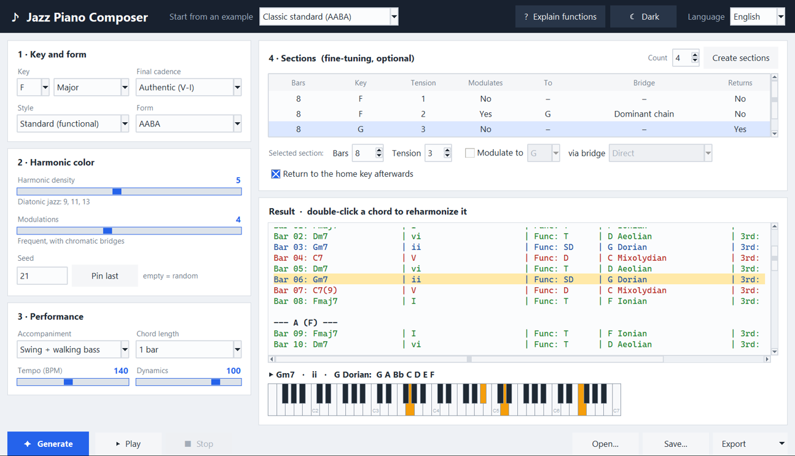
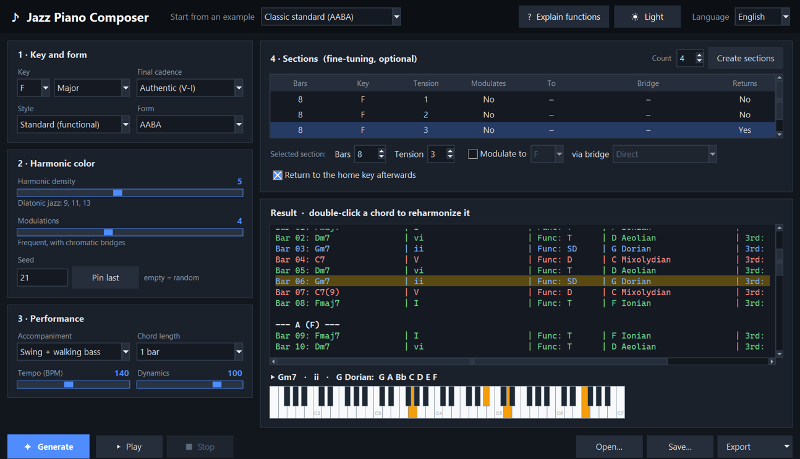

# Jazz Piano Composer

[](https://github.com/aloks93/jazz-piano-composer/actions/workflows/tests.yml)
[](LICENSE)

An educational jazz progression generator with a built-in synthesizer.

It composes chord progressions with real harmonic logic, **explains every chord** (degree,
function, suggested scale, guide-tone motion) and plays them back with comping and a walking
bass — no MIDI devices, soundfonts or drivers required.



<details>
<summary>Dark theme</summary>



</details>

## Features

- **Harmony that makes sense** — ii–V–I cadences, turnarounds, secondary dominants, tritone
  substitutions, backdoor cadences and six modulation strategies (pivot chords, dominant
  chains, Coltrane-style major-third moves…).
- **Major and minor keys** — iiø–V7alt–i, minor blues and a melodic-minor tonic at high
  density. Chords are spelled for the key they are in (B♭ in F, F♯ in D).
- **Styles and forms** — functional standards, 12-bar blues, jazz blues, modal vamps and
  Coltrane changes, arranged as AABA, ABAC, AB, blues or Rhythm Changes.
- **Phrased like a tune** — each section opens on the tonic, moves away, and closes with a
  cadence on its tonic.
- **An educational panel** — every bar shows the chord, its roman numeral, its function
  (tonic / subdominant / dominant), a scale to improvise with, and how the 3rd and 7th move.
- **Accompaniment** — sustained chords, swing comping with anticipations, swing with a
  walking bass, or bossa nova. Voicings follow voice-leading rules (shell, drop-2, rootless).
- **Follow along** — during playback the sounding chord is highlighted and its voicing is
  shown on a piano keyboard, with the notes of the suggested scale.
- **Reharmonize by hand** — double-click any chord and type another one.
- **Reproducible** — a seed repeats a progression exactly; projects are saved as JSON.
- **Export** — text, WAV audio and standard MIDI files.
- **Friendly interface** — one-click examples, a one-sentence explanation of every control,
  light and dark themes, English and Spanish.

## Getting started

Requires Python 3.10 or newer (with Tkinter, which ships with the standard installers).

```bash
git clone https://github.com/aloks93/jazz-piano-composer.git
cd jazz-piano-composer
pip install -r requirements.txt
python main.py
```

Then pick an example in **Start from an example**, or set the numbered steps yourself and
press **Generate**. The **? Explain functions** button describes every control.

## Using the engine from code

The engine has no UI dependencies, so it can be scripted:

```python
from jazz_composer.composer import CompositionSettings, compose, plan_sections
from jazz_composer.midi import write_midi
from jazz_composer.performance import FEEL_SWING_BASS, build_performance
from jazz_composer.synth import write_wav

sections = plan_sections(3, "Eb", mod_density=5)
comp = compose(sections, CompositionSettings(start_key="Eb", form="AABA", density=7, seed=42))
print([chord.symbol for chord in comp.chords])   # the same seed gives the same progression

perf = build_performance(comp.playback, density=7, feel=FEEL_SWING_BASS, bpm=140)
write_wav("demo.wav", perf, bpm=140)
write_midi("demo.mid", perf, bpm=140)
```

## How it is organized

Each layer only depends on the ones above it.

| Module | Responsibility |
| --- | --- |
| `theory.py` | Notes, scales, chord symbols, key-aware spelling |
| `models.py` | Shared dataclasses (`Chord`, `Section`, `Block`…) |
| `harmony.py` | Tension palettes, cadences, turnarounds, secondary dominants |
| `modulation.py` | Target keys, strategies and bridge chords |
| `generators.py` | One progression generator per style |
| `scales.py` | Chord-scale suggestions |
| `composer.py` | Sections → form → final cadence → panel text |
| `voicing.py` | Chords → MIDI notes with voice leading |
| `performance.py` | Progression → timed notes (comping, walking bass, bossa) |
| `synth.py` | Additive synthesis with NumPy, WAV export |
| `midi.py` | Standard MIDI File export, no dependencies |
| `project.py` | Save and load projects as JSON |
| `audio.py` | Playback through pygame |
| `ui/` | Tkinter application: themes, translations, presets, help |

## Tests

```bash
pip install pytest
python -m pytest
```

The test suite covers the theory, every style × form × mode combination, voicings, the
synthesizer, MIDI output and the translations. It does not need a display or an audio device.

## Limitations

This is a study aid, not a replacement for a teacher, a method book or real tunes.

- The sound is a simple additive synthesizer, not a sampled piano.
- Progressions use one chord per bar and have no melody.
- Chord-scale suggestions follow fixed rules; in practice several scales are often valid.
- The mode (major or minor) is global: a piece cannot modulate between the two.

## License

[MIT](LICENSE) © Lucas Espínola
